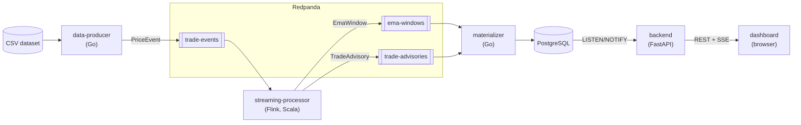

# Financial Streaming Platform

This project replays the [DEBS 2022 Grand Challenge](https://zenodo.org/records/6382482)
trading data through a streaming pipeline. For every symbol it computes EMA 38 and
EMA 100 over five-minute windows and raises a BUY or SELL advisory when the two cross.
The results show up in a live dashboard.



Each part has its own README:
[data-producer](services/data-producer/README.md),
[streaming-processor](services/streaming-processor/README.md),
[materializer](services/materializer/README.md),
[backend](services/backend/README.md),
[frontend](services/frontend/README.md),
[schemas](schemas/market/v1/README.md),
[validation](validation/README.md) and
[monitoring](monitoring/README.md).

## Getting started

You need Docker with Compose and Python 3. Working on the services themselves also
needs Go, Java 17 with sbt, and Node.js 22.

```
cp .env.example .env
make download-dataset DATASET_DAYS=08-11-21
make run-flow
```

Leave out `DATASET_DAYS` to download all five trading days into `dataset/`.

`make run-flow` starts Redpanda, PostgreSQL and Flink, applies any missing database
migrations, submits the Flink job, and then runs the materializer, the backend and the
producer. Once it's up, the dashboard is at http://localhost:8000.

Ctrl+C stops the producer, materializer and backend. Redpanda, PostgreSQL and the Flink
job keep running, so the next `make run-flow` picks up where you left off. To stop
everything, or to start over with empty topics and an empty database:

```
make stop-flow
make reset-flow
```

For a shorter run, pass flags to the producer:

```
make run-flow PRODUCER_ARGS="-rate=1000 -maxEvents=100000"
```

Running `make` on its own lists every target.

## Local addresses

The Redpanda Console is at http://localhost:8080 and the Flink dashboard at
http://localhost:8081. From the host, Redpanda listens on `localhost:19092` and
PostgreSQL on `localhost:15432`, with the credentials from `.env.example`.
`make postgres-shell` opens `psql`.

Inside Compose, containers use `redpanda-0:9092` and `postgres:5432` instead. The
`MATERIALIZER_*` values in `.env` are only for tools that run on the host.

## Running on three brokers

By default there is one Redpanda broker and every topic has one partition. For scaling
experiments, `CLUSTER=1` starts three brokers and replicates every topic to all of them.
`PARTITIONS` sets the partitions per topic, and `FLINK_PARALLELISM` the number of Flink
tasks. Keep the two equal so that each task reads one partition.

```
make reset-flow
make measure-flow CLUSTER=1 PARTITIONS=4 FLINK_PARALLELISM=4 CSV=dataset RATE=50000
make reset-flow CLUSTER=1
```

Use the same `CLUSTER` value for every command in a session. Broker data from one mode
doesn't work in the other, so run `make reset-flow` in the old mode before you switch.
Each broker takes `REDPANDA_MEMORY` (2G by default), so give Docker enough memory for
three of them next to Flink.

## Development

Run this once after cloning:

```
make setup-hooks
```

The pre-commit hook formats staged Go and Scala files. It skips a language if its
toolchain isn't installed, but CI still checks it. `make formatall` formats everything,
and `make test-validation` runs the Python tests for validation, the flow scripts and
monitoring. Each service README covers its own tests.

There are a few longer notes in `docs/`:

- [Why the watermark allows 5 seconds of lateness](docs/out-of-orderness.md)
- [Database tables and migrations](docs/database.md)
- [Which CI workflows run when](docs/ci.md)
